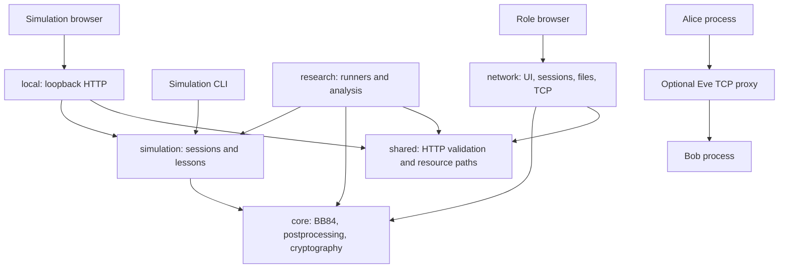

# BB84 Lab

Classical BB84 and E91 simulations, QBER and CHSH monitoring, educational key postprocessing, and an Alice–Eve–Bob file-transfer demonstration.

[Tiếng Việt](README.vi.md) · [Research model](docs/RESEARCH.md) · [Network guide](docs/NETWORK_DEMO.md) · [Contributing](CONTRIBUTING.md)

BB84 Lab is a Python research and teaching project for studying how sampling, noise and intercept–resend affect BB84 sessions. It connects these experiments to authenticated encryption and records reproducible public statistics.

**This is classical simulation, not physical QKD.** Public simulation seeds reproduce the raw/sifted key material; the model key can be reconstructed with the public postprocessing transcript. Fresh Toeplitz randomness and session context mean rerunning a simulation seed alone does not reproduce the final application key. Network “quantum states” are software data that can be copied without causing disturbance. Use demonstration content only. This implementation does not establish real-world QKD secrecy or finite-key/composable security.

## What BB84 does

Alice encodes random bits in two bases, conventionally Z and X. Bob independently chooses measurement bases. They publicly compare bases, retain matching positions, disclose a random sample to estimate the quantum bit error rate (QBER), then remove that sample. Error correction and privacy amplification process the remaining material. The classical discussion requires separate authentication.

The lab models these steps with classical randomness. For intercept fraction `f` and independent post-measurement bit-flip probability `p`, expected sifted QBER is `p + f/4 - p*f/2`. Full intercept–resend without background noise gives an expectation of 25%; an individual run can differ. High QBER does not uniquely identify Eve, and low QBER does not prove her absence.

## Implemented capabilities

| Area | Available behavior |
|---|---|
| BB84/QBER | Seeded Monte Carlo, basis sifting, sample removal, Wilson 95% interval, `continue` / `anomalous` / `inconclusive` decisions |
| Key processing | Educational four-pass Cascade with lookback, SHA-256 confirmation, Toeplitz hashing, disclosure/entropy budget, abort on failure |
| Cryptography | HMAC-SHA256 discussion authentication, HKDF context binding, `cryptography` ChaCha20-Poly1305, nonce counters, tamper/replay rejection |
| Simulation dashboard | Vietnamese UI, BB84 scenarios and 16-signal lesson, E91 with CHSH and QBER calculations, packet inspector, public verification JSON/CSV, completed-study viewer |
| Independent peers | Alice/Bob processes and optional PSK-free Eve proxy, six proxy modes, role dashboards on loopback |
| File transfer | Text/arbitrary files, 64 KiB chunks, 512 MiB default limit, authenticated completion, size/SHA-256 checks, HTTP Range playback/download |
| Research | Separate calibration/held-out seeds, frozen sampling selection, paired bootstrap, measured postprocessing, five PNG/SVG plot groups, optional Qiskit/Aer checks |

## Choose a mode

| Mode | Command | Execution and purpose |
|---|---|---|
| Simulation CLI | `python -m bb84_lab.simulation bb84` | Alice and Bob share one process; seeded public statistics |
| Local dashboard | `python -m bb84_lab.local --open` | Browser UI for the in-process model; HTTP binds to loopback |
| Network demonstration | `python -m bb84_lab.network ...` | Independent TCP processes; bits/bases use OS randomness |

The network dashboard controls its own role; it does not distribute the simulation dashboard. Video is transferred as a complete file before playback. Live calls/streaming are not implemented.

## Install from a checkout

Python **3.14** is the documented target. Local release checks use Windows/Python 3.14.5; CI is configured for Python 3.14 on Windows and Ubuntu. Other versions have not been certified by this audit.

```sh
git clone https://github.com/philiaa093/Project_MHMM.git
cd Project_MHMM
python -m venv .venv
```

Windows PowerShell:

```powershell
.\.venv\Scripts\python.exe -m pip install -r requirements.txt
.\.venv\Scripts\python.exe -m pip check
.\.venv\Scripts\python.exe -m tests.self_check
.\.venv\Scripts\python.exe -m bb84_lab.local --open
```

Linux/macOS shell:

```sh
.venv/bin/python -m pip install -r requirements.txt
.venv/bin/python -m pip check
.venv/bin/python -m tests.self_check
.venv/bin/python -m bb84_lab.local --open
```

Open `http://127.0.0.1:8765`; stop with `Ctrl+C`. Use `--port 8766` if needed, or omit `--open` on a machine without a browser. The UI is Vietnamese. No Node.js, cloud account, environment variables or optional research dependencies are required for the application/self-check.

### Learn the project from the beginning

```powershell
.\.venv\Scripts\python.exe -m bb84_lab.local --learn
```

This opens the Vietnamese learning site at `http://127.0.0.1:8765/learn/`: 15 lessons covering fundamentals, BB84/E91, monitoring, postprocessing, cryptography, networking, research and graph reading; 32 self-check questions; interactive examples and study charts; a module map; a glossary and searchable abbreviations/symbols; and browser-local notes/progress. Practical exercises call the existing backend. The read-only code viewer serves current files from an explicit source allowlist. The simulation dashboard links to **Học project từ đầu**. See the [learning site guide](docs/LEARNING_WEB.md).

Run commands from the repository root. Below, `python` means the virtual environment interpreter: activate it or substitute its explicit path above. The project runs from source; `pip install .` and wheel distribution are not configured.

## Simulation examples

```sh
python -m bb84_lab.simulation bb84
python -m bb84_lab.simulation bb84 --eve 1
python -m bb84_lab.simulation bb84 --noise 0.1
python -m bb84_lab.simulation bb84 --eve 0.1
python -m bb84_lab.simulation bb84 --signals 16
python -m bb84_lab.simulation bb84 --monitor-only
python -m bb84_lab.simulation aead --message "Hello Bob"
```

The CLI emits public JSON statistics, postprocessing status and encryption checks, without printing keys. Monitoring defaults are 4,096 signals, seed 2026, a 25% sample, at least 100 sample bits and a 5% threshold. Continue only when the Wilson upper bound is at or below the threshold; insufficient evidence stops key processing.

A valid JSON result can describe an aborted session with exit code 0: inspect its status. `--tamper-transcript` causes authentication failure and exit code 2. The standalone `aead` command uses an OS-generated random key rather than a BB84 key. See the [model/budget details](docs/RESEARCH.md) and [5–7 minute demo](docs/DEMO.md).

In the local dashboard, open **E91**, set the pair count, seed, and white-noise level, then select **So sánh lý tưởng và có nhiễu** (compare ideal and noisy). The side-by-side charts show observed `|S|` and QBER for both runs with the same pair count and seed. Select **Xem nhật ký lý tưởng** or **Xem nhật ký có nhiễu** to see outcome counts, formulas with observed numbers substituted, and 95% intervals. [E91 model and assumptions](docs/RESEARCH.md#mô-phỏng-e91)

## Run Alice, Bob and Eve

For a direct demo, connect two machines to the same LAN or private VPN. Start setup from the project root on each machine.

```sh
python -m bb84_lab.network setup --open
```

Each machine opens its own page at `http://127.0.0.1:8770`. On one machine, select **Tạo PSK** (create PSK) or use its existing PSK. Copy the file shown on the page to the other machine over a private channel and select **Nhập tệp PSK** (import PSK) there. The default file is `outputs/network/auth.key`. In **Giao thức tạo khóa** (key agreement protocol), select the same **BB84** or **E91** on both machines. Start Bob with the IPv4 address of the receiving machine, then start Alice with that same address and TCP port `9100`. To switch protocols, use `Ctrl+C` and relaunch setup on both machines. [Network demo guide](docs/NETWORK_DEMO.md)

To include Eve on Alice's machine, select **Chạy kèm Eve trên máy Alice** on the Alice setup form. Keep Bob's IPv4 address and port in the form, then select **Khởi động Alice và Eve**. Open **Bảng điều khiển Eve** (Eve dashboard) from Alice's dashboard and select a mode for the next transfer. Eve listens locally on Alice's machine and takes no PSK. [Run Eve from browser setup](docs/NETWORK_DEMO.md#chạy-eve-ngay-trên-máy-alice)

On Alice or Bob, use **Terminal tạo khóa → Xem log chi tiết** to follow the current or latest transfer. BB84 shows sifting and QBER. E91 shows CHSH and QBER, and requires both checks to pass before using the shared Cascade, Toeplitz, and ChaCha20-Poly1305 pipeline. Compare the session ID on both machines to match the two traces. The trace stays in memory and keeps the PSK, session key, and private bit strings out of the log. [Session and log guide](docs/NETWORK_DEMO.md#xem-log-của-phiên-truyền)

Open **Tạo khóa từng bước** (key generation step by step) to work through the full multiplication with the input and output bits of a public teaching example.

The command-line example below runs the three BB84 roles as separate processes on one machine. Open three terminals using the same virtual environment. Run `init` once to create a 32-byte PSK file. The command preserves any existing file.

```sh
python -m bb84_lab.network init --psk-file outputs/network/auth.key
```

Start Bob, then Eve, then Alice in separate terminals:

```sh
# Terminal 1: Bob
python -m bb84_lab.network bob --psk-file outputs/network/auth.key --ui-port 8770

# Terminal 2: Eve
python -m bb84_lab.network eve --target 127.0.0.1:9100 --ui-port 8771

# Terminal 3: Alice
python -m bb84_lab.network alice --psk-file outputs/network/auth.key --target 127.0.0.1:9101 --ui-port 8772
```

Open Bob at `http://127.0.0.1:8770`, Eve at `http://127.0.0.1:8771`, Alice at `http://127.0.0.1:8772`. Send text or upload a file on Alice. Bob saves completed files in `outputs/received/`.

Eve supports `pass`, `intercept`, `tamper`, `replay`, `drop`, `tamper-public`. Full interception is expected to trigger QBER rejection; weak interception can go undetected. Authentication/order checks reject tamper/replay. To bypass Eve, point Alice at `127.0.0.1:9100`. Inspect actual options with `python -m bb84_lab.network alice --help` (or `bob`, `eve`, `init`).

Across hosts, provide Alice and Bob with the **same PSK through a trusted separate channel**, never give it to Eve, and bind TCP listeners to reachable private/VPN addresses using `--listen-host`. Dashboards remain loopback-only. Follow the [two-laptop/VM guide](docs/NETWORK_DEMO.md) for addresses, firewall checks and limits. Automated tests use loopback; Internet deployment needs verification on the target devices.

## Reproduce research

A new clone has no datasets/figures in `outputs/`. The dashboard works without them; its study page reports no dataset until a completed study exists. Choose a new output directory for every run:

```sh
# Runtime dependencies only; smoke data cannot support research conclusions
python -m bb84_lab.research.study --quick --no-plots --output outputs/study-smoke-new
python -m bb84_lab.local --study-dir outputs/study-smoke-new

# Simple paired experiment runner; default config: configs/smoke.json
python -m bb84_lab.research.experiments --output outputs/smoke-new

# Optional plotting and circuit dependencies; retain pinned versions
python -m pip install -r requirements-research.txt
python -m pip check
python -m bb84_lab.research.verify_quantum --output outputs/quantum-new.json
python -m bb84_lab.research.study --output outputs/study-new
python -m bb84_lab.research.study --output outputs/study-new --postprocess
python -m bb84_lab.research.plot_results outputs/study-new
```

The full configuration has 1,800 main and 1,500 held-out independent sessions. Calibration reuses a main subset; postprocessing replays the same sessions rather than adding independent observations. Preserve manifests, seeds, configuration and CSV/JSON together. Plot regeneration overwrites figures in the selected dataset; use a copy to preserve originals. See [research procedure/output formats](docs/RESEARCH.md) and the [Vietnamese proposal](docs/de_cuong_QKD_3_tuan.md).

### BB84–E91 operational comparison

```sh
python -m bb84_lab.research.comparison --quick --no-plots --output outputs/comparison-smoke-new
python -m bb84_lab.research.comparison --output outputs/comparison-new
python -m bb84_lab.network.benchmark --output outputs/system-new
python -m bb84_lab.research.plot_comparison outputs/system-new --system
```

The full design has 8,800 independent measurement sessions with actual shared Cascade, confirmation and Toeplitz processing, including unsuccessful attempts. It reports both equal signal/pair counts and equal endpoint-measurement budgets, with public disclosures recorded separately. The QBER-only E91 ablation reuses measurements and adds no independent sessions. A two-process TCP benchmark measures file transfer, timing and resources on the same host; plotting needs Matplotlib and RSS sampling needs psutil. The attack models are explicitly different. See the [comparison design, metric definitions and limitations](docs/COMPARISON.md) (Vietnamese).

`outputs/` is ignored because it also contains private PSKs, uploads and received content. Ignored research data still needs backup. Publishing a curated dataset requires separate review; do not force-add the entire directory.

## Architecture



| Path | Responsibility |
|---|---|
| `bb84_lab/core/` | BB84, Cascade/Toeplitz and cryptography |
| `bb84_lab/simulation/` | In-process sessions, lessons and CLI |
| `bb84_lab/local/` | Simulation HTTP dashboard |
| `bb84_lab/network/` | Independent configuration, sessions, packets, files, TCP, proxy, service state, UI and CLI |
| `bb84_lab/research/` | Analysis, runners, plots and quantum verification |
| `bb84_lab/shared/` | Loopback HTTP infrastructure and project resource paths |
| `web/simulation/`, `web/network/`, `web/shared/` | Browser assets and shared CSS |
| `configs/`, `tests/`, `docs/` | Source configurations, assert suites and documentation |
| `outputs/` | Generated research, figures, uploads and received content; local only |

The package root contains only `__init__.py`. Network code does not import the local dashboard or simulation. Resource defaults resolve through `shared/paths.py`; explicit CLI paths are relative to the working directory. The [architecture/migration reference](docs/REORGANIZATION.md) contains the full tree and enforced dependency boundaries.

## Validation and development

```sh
python -m pip check
python -m tests.self_check
git diff --check
```

Do not use `-O`: it disables assertions and the runner rejects it. Suites cover structure/import boundaries, sampling, key processing, AEAD/nonces/replay, HTTP resources and real TCP/file transfers with attacks. Base checks must not import optional plotting/Qiskit libraries. [GitHub Actions](.github/workflows/checks.yml) runs base checks and a smoke study on Windows/Ubuntu; browser automation and full research runs are separate. See the [release audit](docs/RELEASE_AUDIT.md) for observed results and outstanding verification.

## Scope and future work

The entropy budget, Wilson interval and safety margin are educational assumptions, not a QKD security proof. Software timing is not physical QKD throughput. There is no optical channel, device security proof, persistent key management, transfer resume, two-way messaging or live video. If the connection drops after Bob saves a file but before the receipt arrives, Alice can report failure despite successful delivery; inspect Bob's inbox before retrying.

Future research may cover device/channel models, compatible finite-key analysis, broader deployment tests and transfer recovery. These are directions, not implemented features or release promises.

## Contributions and license status

See [CONTRIBUTING.md](CONTRIBUTING.md) for checks, evidence and PR guidance. No project license has been selected or included. The owner must confirm licensing and contribution terms before an open-source release; this README does not grant a license. The [changelog](CHANGELOG.md) records unreleased work without claiming a version/tag.
