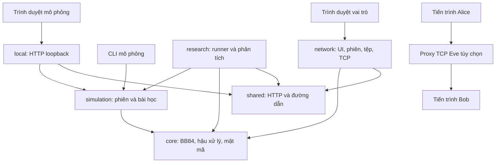

# BB84 Lab

Mô phỏng BB84 và E91 trên máy cổ điển, theo dõi QBER và CHSH, minh họa hậu xử lý khóa và truyền tệp Alice–Eve–Bob.

[English](README.md) · [Mô hình nghiên cứu](docs/RESEARCH.md) · [Hướng dẫn mạng](docs/NETWORK_DEMO.md) · [Đóng góp](CONTRIBUTING.md)

BB84 Lab phục vụ học tập và nghiên cứu ảnh hưởng của lấy mẫu, nhiễu và chặn–đo–gửi lại đến BB84. Dự án kết nối mô phỏng với minh họa mã hóa có xác thực và lưu thống kê công khai để tái lập thí nghiệm.

**Đây là mô phỏng cổ điển, không phải QKD vật lý.** Seed công khai tái tạo vật liệu khóa thô/sàng lọc; có thêm transcript hậu xử lý công khai thì có thể dựng lại khóa mô hình. Ngẫu nhiên Toeplitz và ngữ cảnh phiên mới khiến chạy lại riêng seed mô phỏng không cho cùng khóa ứng dụng cuối. Trong chế độ mạng, trạng thái lượng tử là dữ liệu phần mềm có thể sao chép mà không gây QBER. Chỉ dùng nội dung demo; không dùng khóa này bảo vệ dữ liệu thật hoặc suy ra an toàn finite-key/composable.

## BB84 là gì?

Alice chuẩn bị bit ngẫu nhiên theo hai cơ sở Z/X; Bob chọn cơ sở đo độc lập. Hai bên công khai so sánh cơ sở, giữ vị trí trùng, lấy mẫu ngẫu nhiên để ước lượng tỷ lệ lỗi bit lượng tử (QBER), rồi loại mẫu khỏi vật liệu khóa. Phần còn lại đi qua đối soát lỗi và khuếch đại tính riêng tư. Kênh thảo luận cổ điển cần được xác thực riêng.

Với tỷ lệ chặn `f` và xác suất lật bit sau phép đo `p`, mô hình có QBER kỳ vọng `p + f/4 - p*f/2`. Eve chặn toàn phần khi không nhiễu cho kỳ vọng 25%, không bắt buộc mỗi phiên bằng đúng 25%. QBER cao không xác định chắc chắn Eve; QBER thấp không chứng minh vắng Eve.

## Tính năng đã triển khai

| Nhóm | Chức năng |
|---|---|
| BB84/QBER | Monte Carlo có seed, sàng lọc, loại mẫu, Wilson 95%, `continue` / `anomalous` / `inconclusive` |
| Hậu xử lý | Cascade giáo dục bốn lượt có lookback, xác nhận SHA-256, Toeplitz, ngân sách rò rỉ/entropy và hủy khi thất bại |
| Mật mã | HMAC-SHA256, HKDF ràng buộc ngữ cảnh, ChaCha20-Poly1305 của `cryptography`, nonce bộ đếm, từ chối sửa gói/phát lại |
| Dashboard mô phỏng | Kịch bản và bài học BB84 16 tín hiệu, mô phỏng E91 có nhật ký CHSH và QBER, xem gói, JSON/CSV kiểm chứng công khai, xem study hoàn tất |
| Mạng | Alice/Bob/Eve độc lập, Eve không có PSK, sáu chế độ proxy, dashboard loopback từng vai trò |
| Truyền tệp | Văn bản/tệp bất kỳ, khối 64 KiB, mặc định 512 MiB, xác thực hoàn tất, kích thước/SHA-256, HTTP Range |
| Nghiên cứu | Seed hiệu chỉnh/đánh giá riêng, đóng băng lựa chọn mẫu, bootstrap ghép cặp, đo hậu xử lý, năm nhóm hình PNG/SVG, Qiskit/Aer tùy chọn |

## Chọn chế độ

| Chế độ | Lệnh | Phạm vi |
|---|---|---|
| CLI mô phỏng | `python -m bb84_lab.simulation bb84` | Alice và Bob cùng tiến trình; thống kê tái lập bằng seed |
| Dashboard cục bộ | `python -m bb84_lab.local --open` | Giao diện cho mô hình cùng tiến trình; HTTP loopback |
| Demo mạng | `python -m bb84_lab.network ...` | Tiến trình TCP độc lập; bit/cơ sở lấy ngẫu nhiên từ hệ điều hành |

Dashboard mạng điều khiển vai trò của chính nó. Video là tệp truyền hoàn tất rồi phát; chưa có gọi/livestream.

## Cài đặt từ checkout

Mục tiêu môi trường là **Python 3.14**; kiểm tra phát hành cục bộ dùng Windows/Python 3.14.5. CI được cấu hình cho Python 3.14 trên Windows và Ubuntu. Chưa xác nhận các phiên bản khác.

```sh
git clone https://github.com/philiaa093/Project_MHMM.git
cd Project_MHMM
python -m venv .venv
```

PowerShell trên Windows:

```powershell
.\.venv\Scripts\python.exe -m pip install -r requirements.txt
.\.venv\Scripts\python.exe -m pip check
.\.venv\Scripts\python.exe -m tests.self_check
.\.venv\Scripts\python.exe -m bb84_lab.local --open
```

Linux/macOS:

```sh
.venv/bin/python -m pip install -r requirements.txt
.venv/bin/python -m pip check
.venv/bin/python -m tests.self_check
.venv/bin/python -m bb84_lab.local --open
```

Mở `http://127.0.0.1:8765`; dừng bằng `Ctrl+C`. Đổi cổng bằng `--port 8766`; máy không có trình duyệt có thể bỏ `--open`. Không cần Node.js, cloud, biến môi trường hoặc dependency nghiên cứu cho ứng dụng/self-check.

Chạy lệnh tại gốc repository. Trong các ví dụ sau, `python` là Python của môi trường ảo: kích hoạt môi trường hoặc thay bằng đường dẫn tường minh ở trên. Dự án chạy từ checkout; chưa cấu hình `pip install .` hoặc wheel.

## Mô phỏng và Dashboard

```sh
python -m bb84_lab.local --open
python -m bb84_lab.simulation bb84
python -m bb84_lab.simulation bb84 --eve 1
python -m bb84_lab.simulation bb84 --noise 0.1
python -m bb84_lab.simulation bb84 --eve 0.1
python -m bb84_lab.simulation bb84 --signals 16
python -m bb84_lab.simulation bb84 --monitor-only
python -m bb84_lab.simulation aead --message "Xin chào Bob"
```

Mặc định: 4.096 tín hiệu, seed 2026, mẫu 25%, ít nhất 100 mẫu, ngưỡng 5%. Chỉ tiếp tục khi cận trên Wilson không vượt ngưỡng; thiếu bằng chứng thì dừng xử lý khóa. CLI trả JSON công khai về thống kê, hậu xử lý và mã hóa, không in khóa.

Phiên hủy theo QBER có thể trả JSON với mã thoát 0; phải đọc trường trạng thái. `--tamper-transcript` gây lỗi xác thực và mã thoát 2. Lệnh `aead` riêng dùng khóa ngẫu nhiên từ hệ điều hành, không dùng khóa BB84.

Dashboard có bài học từng bước, xem gói/sửa gói/giải mã/phát lại và nhật ký công thức thực thi. Bit công khai trong bài học không đi vào mã hóa. Gói demo giữ trong RAM có giới hạn; chỉ dùng thông điệp công khai. Xem [kịch bản 5–7 phút](docs/DEMO.md), [thiết kế UI](docs/UI_DESIGN.md), [chi tiết mô hình/ngân sách](docs/RESEARCH.md).

Trên dashboard cục bộ, mở **E91**, nhập số cặp và seed, đặt mức nhiễu trắng rồi bấm **So sánh lý tưởng và có nhiễu**. Hai biểu đồ đặt cạnh nhau hiển thị `|S|` và QBER đo được từ hai lượt dùng chung số cặp và seed. Để đọc nhật ký từng lượt, bấm **Xem nhật ký lý tưởng** hoặc **Xem nhật ký có nhiễu**. Nhật ký CHSH và QBER hiển thị số đếm kết quả đo, công thức đã thay số và khoảng 95%. [Mô hình và giả định E91](docs/RESEARCH.md#mô-phỏng-e91)

## Alice–Bob–Eve qua mạng

Để gửi trực tiếp giữa hai máy, kết nối hai máy vào cùng mạng LAN hoặc VPN riêng. Chạy lệnh sau tại thư mục gốc dự án trên cả hai máy.

```sh
python -m bb84_lab.network setup --open
```

Mỗi máy mở trang của mình tại `http://127.0.0.1:8770`. Bấm **Tạo PSK** trên một máy hoặc dùng tệp PSK đã có. Chuyển riêng tệp ở đường dẫn hiển thị sang máy kia rồi bấm **Nhập tệp PSK** trên máy đó. Tệp mặc định là `outputs/network/auth.key`. Trong **Giao thức tạo khóa**, chọn cùng **BB84** hoặc **E91** trên cả hai máy. Khởi động Bob với IPv4 của máy nhận trước, rồi khởi động Alice với cùng IPv4 và cổng TCP `9100`. Để đổi giao thức, nhấn `Ctrl+C` và chạy lại Setup trên cả hai máy. [Hướng dẫn demo mạng](docs/NETWORK_DEMO.md)

Để chạy Eve trên máy Alice, chọn **Chạy kèm Eve trên máy Alice** trong trang thiết lập. Giữ IPv4 và cổng TCP của Bob trong biểu mẫu rồi bấm **Khởi động Alice và Eve**. Mở **Bảng điều khiển Eve** từ dashboard Alice để chọn chế độ cho lượt gửi tiếp theo. Eve chỉ lắng nghe trên máy Alice và không dùng PSK. [Chạy Eve từ giao diện thiết lập](docs/NETWORK_DEMO.md#chạy-eve-ngay-trên-máy-alice)

Trên Alice hoặc Bob, mở **Terminal tạo khóa → Xem log chi tiết**. BB84 hiển thị sàng lọc và QBER. E91 hiển thị CHSH và QBER, cả hai phải đạt điều kiện mô hình thì phiên mới đi tiếp. Cả hai giao thức dùng Cascade, Toeplitz và ChaCha20-Poly1305 sau khi qua giám sát. Đối chiếu mã phiên trên hai máy để ghép hai log. Log nằm trong RAM và giữ kín PSK, khóa phiên và các chuỗi bit bí mật. [Quy trình và log](docs/NETWORK_DEMO.md#xem-log-của-phiên-truyền)

Mở **Tạo khóa từng bước** để xem trọn phép nhân cùng các bit đầu vào và đầu ra trong một ví dụ giảng dạy công khai.

Ví dụ dòng lệnh dưới đây chạy BB84 với ba vai trò riêng trên một máy. Mở ba terminal với cùng môi trường ảo. Chạy `init` một lần để tạo tệp PSK 32 byte. Lệnh giữ nguyên tệp đã có.

```sh
python -m bb84_lab.network init --psk-file outputs/network/auth.key
```

Chạy Bob, Eve, Alice theo thứ tự ở ba terminal:

```sh
# Terminal 1: Bob
python -m bb84_lab.network bob --psk-file outputs/network/auth.key --ui-port 8770

# Terminal 2: Eve
python -m bb84_lab.network eve --target 127.0.0.1:9100 --ui-port 8771

# Terminal 3: Alice
python -m bb84_lab.network alice --psk-file outputs/network/auth.key --target 127.0.0.1:9101 --ui-port 8772
```

Mở Bob ở `http://127.0.0.1:8770`, Eve ở `http://127.0.0.1:8771`, Alice ở `http://127.0.0.1:8772`. Gửi văn bản/tệp trên Alice; Bob lưu tệp hoàn tất tại `outputs/received/`.

Eve có `pass`, `intercept`, `tamper`, `replay`, `drop`, `tamper-public`. Chặn toàn phần thường gây hủy theo QBER; chặn yếu có thể không bị phát hiện. Kiểm tra xác thực/thứ tự từ chối sửa gói và phát lại. Đi thẳng: Alice dùng `--target 127.0.0.1:9100`. Tra tùy chọn bằng `python -m bb84_lab.network alice --help`, tương tự cho `bob`, `eve`, `init`.

Khi khác máy, Alice và Bob dùng **cùng PSK chuyển riêng qua kênh tin cậy**, không cấp cho Eve. Dùng `--listen-host` với địa chỉ mạng riêng/VPN có thể truy cập; dashboard luôn loopback. [Hướng dẫn hai laptop/VM](docs/NETWORK_DEMO.md) có địa chỉ, firewall và giới hạn vận hành. Kiểm thử tự động dùng loopback; Internet thật cần thử trên thiết bị đích.

## Tái lập nghiên cứu

Clone mới không có dữ liệu/biểu đồ trong `outputs/`. Dashboard vẫn chạy; trang Thí nghiệm báo chưa có dữ liệu cho tới khi có study hoàn tất. Dùng thư mục đầu ra mới cho mỗi lượt:

```sh
# Không cần dependency nghiên cứu; smoke không dùng để kết luận khoa học
python -m bb84_lab.research.study --quick --no-plots --output outputs/study-smoke-new
python -m bb84_lab.local --study-dir outputs/study-smoke-new
python -m bb84_lab.research.experiments --output outputs/smoke-new

# Tùy chọn: biểu đồ và kiểm chứng mạch; giữ nguyên phiên bản đã pin
python -m pip install -r requirements-research.txt
python -m pip check
python -m bb84_lab.research.verify_quantum --output outputs/quantum-new.json
python -m bb84_lab.research.study --output outputs/study-new
python -m bb84_lab.research.study --output outputs/study-new --postprocess
python -m bb84_lab.research.plot_results outputs/study-new
```

Cấu hình đầy đủ có 1.800 phiên chính và 1.500 phiên đánh giá độc lập. Hiệu chỉnh dùng tập con bộ chính; hậu xử lý chạy lại cùng phiên, không tăng số quan sát độc lập. Giữ manifest, seed, cấu hình và CSV/JSON cùng nhau. Vẽ lại ghi đè hình trong bộ được chọn; dùng bản sao nếu cần giữ hình gốc. Xem [quy trình/định dạng đầu ra](docs/RESEARCH.md) và [đề cương](docs/de_cuong_QKD_3_tuan.md).

`outputs/` bị Git bỏ qua vì còn chứa PSK, upload và tệp nhận. Dữ liệu nghiên cứu bị ignore vẫn cần sao lưu. Công bố bộ dữ liệu cần tuyển chọn/rà soát riêng; không force-add toàn thư mục.

## Kiến trúc



| Đường dẫn | Trách nhiệm |
|---|---|
| `bb84_lab/core/` | BB84, Cascade/Toeplitz, mật mã |
| `bb84_lab/simulation/` | Phiên cùng tiến trình, bài học, CLI |
| `bb84_lab/local/` | Dashboard HTTP mô phỏng |
| `bb84_lab/network/` | Cấu hình, phiên, gói, tệp, TCP, Eve, trạng thái, UI, CLI |
| `bb84_lab/research/` | Phân tích, runner, biểu đồ, kiểm chứng lượng tử |
| `bb84_lab/shared/` | Hạ tầng HTTP và đường dẫn tài nguyên |
| `web/simulation/`, `web/network/`, `web/shared/` | Giao diện, CSS chung |
| `configs/`, `tests/`, `docs/` | Cấu hình nguồn, nhóm assert, tài liệu |
| `outputs/` | Nghiên cứu, hình, upload, tệp nhận; chỉ cục bộ |

Gốc package chỉ có `__init__.py`; mạng không import Dashboard mô phỏng hoặc `simulation`. Tài nguyên mặc định qua `shared/paths.py`; đường dẫn CLI tường minh tính theo thư mục làm việc. [Kiến trúc và ánh xạ di chuyển](docs/REORGANIZATION.md) có cây và ranh giới phụ thuộc đầy đủ.

## Kiểm thử

```sh
python -m pip check
python -m tests.self_check
git diff --check
```

Không dùng `-O`, vì tắt assert và runner từ chối. Suite kiểm tra cấu trúc/import, lấy/loại mẫu, khóa, AEAD/nonce/replay, HTTP và truyền tệp TCP thật với các chế độ can thiệp. Kiểm thử cơ bản không được import dependency nghiên cứu. [GitHub Actions](.github/workflows/checks.yml) chạy self-check và smoke trên Windows/Ubuntu; kiểm tra trình duyệt và nghiên cứu đầy đủ chạy riêng. [Biên bản phát hành](docs/RELEASE_AUDIT.md) ghi kết quả thực tế và việc còn lại.

## Giới hạn và định hướng

Wilson, ngân sách entropy và biên dự phòng là giả định giáo dục, không phải chứng minh QKD. Thời gian phần mềm không phải tốc độ QKD vật lý. Chưa có kênh quang, chứng minh an toàn thiết bị/finite-key, quản lý khóa lâu dài, tiếp tục truyền dở, nhắn tin hai chiều hoặc video trực tiếp. Nếu mất kết nối sau khi Bob lưu nhưng trước biên nhận, Alice có thể báo lỗi dù tệp đã nhận đủ; kiểm tra hộp nhận trước khi gửi lại.

Hướng nghiên cứu gồm mô hình thiết bị/kênh, phân tích finite-key phù hợp, kiểm chứng triển khai rộng hơn và khôi phục truyền. Đây là định hướng, chưa phải tính năng hoặc cam kết phát hành.

## Đóng góp và giấy phép

Xem [CONTRIBUTING.md](CONTRIBUTING.md) về kiểm tra, bằng chứng và PR. Dự án chưa chọn/kèm giấy phép. Chủ sở hữu cần xác nhận giấy phép và điều kiện đóng góp trước khi phát hành mã nguồn mở; README không cấp phép sử dụng. [CHANGELOG.md](CHANGELOG.md) chỉ ghi thay đổi chưa phát hành, không tự đặt phiên bản/tag.
