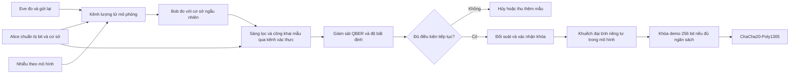

# Đề cương nghiên cứu: Giám sát can thiệp trên kênh phân phối khóa lượng tử bằng BB84

**Phương án đề xuất:** Mô phỏng BB84, giám sát QBER và minh họa sử dụng khóa với ChaCha20-Poly1305.  
**Ngày tổng hợp:** 16/11/2026. **Thời gian thực hiện:** 3 tuần.  
**Phạm vi đã xác nhận:** Giám sát nghe lén trên kênh trao đổi khóa.  
**Giả định nguồn lực:** 1–2 người đã biết Python; khoảng 60–80 giờ công cho phạm vi tối thiểu; máy tính cá nhân; không yêu cầu thiết bị quang học hay tài khoản máy lượng tử.

## 1. Kết luận lựa chọn đề tài

Tên phù hợp để đăng ký:

> **Mô phỏng giao thức BB84 và đánh giá khả năng phát hiện can thiệp trên kênh phân phối khóa lượng tử, kết hợp mã hóa ChaCha20-Poly1305.**

BB84 là giao thức phân phối khóa; ChaCha20-Poly1305 sử dụng khóa đã thiết lập để mã hóa và xác thực dữ liệu. Phần nghiên cứu chính là đánh giá cơ chế giám sát, không phải tự thiết kế thuật toán mật mã mới.

Trong 3 tuần, nên hoàn thành một mô hình Alice–Bob–Eve, bộ thí nghiệm có thể chạy lại, giao diện theo dõi đơn giản và bản demo mã hóa thông điệp. E91 được phân tích trong tổng quan; chỉ bổ sung mô phỏng Bell/CHSH nếu phần chính đã hoàn tất.

**Giá trị của dự án:** làm rõ ảnh hưởng của cỡ mẫu, nhiễu và mức can thiệp đến phát hiện bất thường, tỷ lệ hủy phiên và lượng khóa còn lại. Chỉ thay AES bằng ChaCha20 chưa tạo ra đóng góp nghiên cứu đủ rõ.

**Trọng tâm đối sánh:** dùng BB84 với tỷ lệ lấy mẫu kiểm tra 25% làm phương án chuẩn; khảo sát 10% và 50% để chọn tham số vận hành theo tiêu chí đặt trước. Đây là tối ưu tham số lấy mẫu, không phải đề xuất giao thức QKD mới. Việc một phương án có tốt hơn phương án chuẩn hay không phải được kiểm tra trên dữ liệu độc lập.

**Phương án gọn hơn:** chỉ làm BB84, QBER và thí nghiệm phát hiện; bổ sung demo ChaCha20-Poly1305 sau khi kết quả giám sát đã ổn định.

## 2. Chuẩn hóa khái niệm trước khi nghiên cứu

| Khái niệm | Vai trò | Ví dụ | Liên quan đến đề tài |
|---|---|---|---|
| Phân phối khóa lượng tử, QKD | Thiết lập khóa chung bằng tín hiệu lượng tử và trao đổi cổ điển được xác thực | BB84, E91 | Thành phần chính |
| Mã hóa dữ liệu đối xứng | Bảo vệ dữ liệu bằng khóa đã có | AES, ChaCha20 | Dùng ChaCha20-Poly1305 cho demo |
| Thiết lập khóa hậu lượng tử, PQC | Dùng thuật toán cổ điển có giả định khó trước đối thủ lượng tử | ML-KEM | Hướng triển khai phần mềm thực tế khác QKD |
| Thuật toán lượng tử tấn công mật mã | Giải bài toán nền hoặc tăng tốc tìm kiếm | Shor, Grover | Cơ sở trình bày động cơ nghiên cứu |

AES không phải thuật toán trao đổi khóa. Vì vậy, yêu cầu “AES đã có nhiều, chọn thuật toán khác” nên được đáp ứng bằng hai quyết định riêng: chọn **BB84 cho phân phối khóa**, chọn **ChaCha20-Poly1305 thay AES ở lớp mã hóa dữ liệu**. [S8], [S11]

Shor đe dọa các hệ dựa trên phân tích thừa số hoặc logarit rời rạc khi có máy lượng tử đủ lớn và chịu lỗi. Mô phỏng phân tích số 15 không chứng minh có thể phá RSA với kích thước khóa thực dụng trên thiết bị hiện nay. Grover cung cấp tăng tốc bậc hai cho tìm kiếm vét cạn lý tưởng; không được diễn giải thành việc mọi hệ mật mã đối xứng đều đã bị phá. [S2], [S4]

Mô phỏng BB84 trên máy cổ điển minh họa các phép chuẩn bị và đo, cùng các thống kê của mô hình. Nó không tạo ra đường truyền photon thật và không tự mang lại bảo đảm an toàn vật lý của QKD.

### 2.1. QKD khác trao đổi khóa truyền thống như thế nào?

| Tiêu chí | DH/ECDH truyền thống | QKD, xét BB84 | Thiết lập khóa hậu lượng tử, xét ML-KEM |
|---|---|---|---|
| Cách thiết lập bí mật chung | Trao đổi dữ liệu công khai và thực hiện phép toán trên nhóm hữu hạn hoặc đường cong elliptic | Chuẩn bị và đo trạng thái lượng tử, kết hợp trao đổi cổ điển và xử lý hậu kỳ | Dùng cơ chế đóng gói và giải đóng gói khóa trên máy tính cổ điển |
| Cơ sở an toàn | Độ khó của bài toán logarit rời rạc trong nhóm được chọn | Tính chất của trạng thái và phép đo lượng tử, cùng các giả định thiết bị, xác thực và phân tích an toàn | Độ khó tính toán của các bài toán trên lattice theo giả định của ML-KEM |
| Đối thủ có máy lượng tử đủ mạnh | Shor đe dọa các bài toán nền của DH/ECDH | Phân tích QKD có thể xét đối thủ lượng tử trong mô hình xác định; không có nghĩa mọi triển khai đều an toàn | Được thiết kế để chống các tấn công lượng tử đã biết; vẫn dựa trên giả định tính toán |
| Dấu hiệu nghe lén | Không có cơ chế suy ra nghe lén thụ động từ nhiễu lượng tử | Thống kê kết quả có thể cho thấy can thiệp hoặc kênh không đạt điều kiện | Không có cơ chế giám sát nhiễu lượng tử |
| Yêu cầu kết nối | Kênh mạng cổ điển | Kênh lượng tử thực khi triển khai vật lý và kênh cổ điển được xác thực | Kênh mạng cổ điển |
| Xác thực danh tính | Cần giao thức xác thực thích hợp để chống giả danh/người đứng giữa | Cũng cần xác thực trao đổi cổ điển; demo dùng khóa chia sẻ trước | Cũng cần cơ chế xác thực thích hợp; riêng KEM chưa xác thực danh tính |
| Vai trò trong đề tài | Đối chiếu lý thuyết, không triển khai thêm | Mô phỏng BB84 là đối tượng nghiên cứu chính | Giải thích lựa chọn khác khi chỉ có hạ tầng cổ điển |

QKD không thay thế toàn bộ hệ thống bảo mật. Nó giải quyết việc thiết lập vật liệu khóa theo những điều kiện cụ thể; mã hóa dữ liệu, quản lý phiên và bảo vệ thiết bị đầu cuối vẫn là các bài toán riêng. Các cột trên đối chiếu vai trò của cơ chế, không phải kết quả benchmark tốc độ hay mức an toàn của một sản phẩm. [S8], [S10], [S13], [S16]

### 2.2. Cơ sở lượng tử dùng trong BB84

Một qubit có thể được biểu diễn bằng trạng thái |ψ⟩ = a|0⟩ + b|1⟩, với |a|² + |b|² = 1. BB84 sử dụng hai cơ sở đo:

- **Cơ sở Z:** |0⟩ và |1⟩.
- **Cơ sở X:** |+⟩ = (|0⟩ + |1⟩)/√2 và |−⟩ = (|0⟩ − |1⟩)/√2.

Quy ước mã hóa và phép đo lý tưởng:

| Bit Alice | Cơ sở Alice | Trạng thái gửi | Bob đo cùng cơ sở | Bob đo khác cơ sở |
|---|---|---|---|---|
| 0 | Z | \|0⟩ | Nhận 0 chắc chắn | Nhận 0 hoặc 1, mỗi kết quả xác suất 1/2 |
| 1 | Z | \|1⟩ | Nhận 1 chắc chắn | Nhận 0 hoặc 1, mỗi kết quả xác suất 1/2 |
| 0 | X | \|+⟩ | Nhận 0 chắc chắn | Nhận 0 hoặc 1, mỗi kết quả xác suất 1/2 |
| 1 | X | \|−⟩ | Nhận 1 chắc chắn | Nhận 0 hoặc 1, mỗi kết quả xác suất 1/2 |

Ba nguyên lý cần giải thích trong báo cáo:

1. **Trạng thái không trực giao:** các trạng thái thuộc hai cơ sở Z/X có độ chồng lấp khác 0. Eve không thể phân biệt chắc chắn cả bốn trạng thái chưa biết bằng một phép đo trên một bản sao.
2. **Phép đo và nhiễu do can thiệp:** nếu Eve chọn sai cơ sở rồi gửi lại trạng thái theo kết quả đo, kết quả Bob có thể khác bit Alice. Với chặn–đo–gửi lại toàn phần, Eve sai cơ sở với xác suất 1/2 và gây sai bit với xác suất 1/2 trong trường hợp đó; QBER kỳ vọng trên chuỗi đã sàng lọc là 1/4.
3. **Không thể sao chép hoàn hảo trạng thái lượng tử bất kỳ chưa biết:** Eve không có một phép sao chép tổng quát để giữ bản sao hoàn hảo rồi chuyển nguyên trạng tín hiệu cho Bob. Điều này không có nghĩa không thể sao chép các bit cổ điển hoặc các trạng thái trực giao đã biết.

Tính chồng chất được thể hiện ở |+⟩ và |−⟩ theo cơ sở Z. **BB84 dạng chuẩn bị–đo không bắt buộc sử dụng nguồn vướng víu**; E91 sử dụng các cặp vướng víu. Mỗi giao thức vẫn cần phân tích hậu xử lý và điều kiện thiết bị để lập luận an toàn. [S8], [S9], [S10]

## 3. Tổng quan và thẩm định các tài liệu được cung cấp

### 3.1. Tình trạng truy cập

Trong thư mục dự án chưa có các PDF người dùng liệt kê. Báo cáo này đối chiếu hai URL được cung cấp với các bản công khai tìm được trên trang nhà xuất bản hoặc arXiv. Không mặc định những bản trực tuyến đó trùng tuyệt đối với file PDF chưa được cung cấp.

Mức độ sử dụng nguồn được ghi cụ thể dưới đây. Không dùng các con số hiệu năng của bài khác làm kết quả thực nghiệm của dự án.

| Tài liệu | Nội dung đã đối chiếu và giá trị sử dụng | Hạn chế/cách sử dụng |
|---|---|---|
| **Thực thi một số thuật toán lượng tử cơ bản** — Dụng Văn Lữ, Lê Lệ Hằng, 2022. URL 7832. [S1] | Trang bài báo và tóm tắt: Deutsch–Jozsa, Bernstein–Vazirani, Simon, Grover; triển khai bằng Python/Qiskit. Cung cấp nền tảng về mạch lượng tử và cách mô phỏng. | Không phải công trình triển khai QKD. API Qiskit trong bài thuộc phiên bản cũ; không sao chép môi trường chạy nguyên trạng. |
| **Thuật toán lượng tử phá mã RSA** — Dụng Văn Lữ và cộng sự, 2023. URL 8256. [S2] | Trang bài báo và tóm tắt: Shor, phân tích N = 15, lựa chọn nền tảng Qiskit. Dùng cho phần động cơ chuyển đổi cơ chế thiết lập khóa. | Bài toán minh họa nhỏ; tránh suy rộng sang khả năng phá RSA thực tế. |
| **Quantum-Classical Hybrid Encryption Framework Based on Simulated BB84 and AES-256: Design and Experimental Evaluation** — Hector E. Mozo, bản thảo arXiv 2511.02836, 2025. [S3] | Đã đối chiếu bản văn trực tuyến, đặc biệt phần phương pháp: BB84 mô phỏng, AES-CBC, PBKDF2, HMAC và chữ ký tùy chọn. Hữu ích để tham khảo luồng ứng dụng. | Bản thảo cần thẩm định. Mô tả khóa Bob là tập con khóa Alice và các biểu thức HMAC ở hai phía chưa thể hiện một quy trình đối soát nhất quán. Không dùng trực tiếp làm đặc tả hay bằng chứng an toàn. |
| **The AES-256 Cryptosystem Resists Quantum Attacks** — Rao và cộng sự, 2017, DOI 10.26483/ijarcs.v8i3.3025. [S4] | Trang nhà xuất bản/tóm tắt và phần giải thích Grover được lập chỉ mục: giúp phân biệt tác động lên mật mã đối xứng với tác động của Shor lên RSA/ECC. | Tiêu đề không phải bảo đảm chống mọi kiểu tấn công. Cần giới hạn phát biểu ở mô hình tấn công, tài nguyên và cách triển khai đang xét. Bài này không cung cấp thuật toán trao đổi khóa. |
| **The Quantum Key Distribution Protocol E91.pdf**. Nguồn gần tên tìm được: **The Quantum Key Distribution Protocol E91–A Premier Method to Secure Communication**, Kartheek Ravipati, Srikanth Vemuru, 2025. [S5] | Đã đối chiếu bản văn trực tuyến mô tả cặp vướng víu, chọn cơ sở, kiểm tra Bell và chưng cất khóa. Hỗ trợ giải thích trực quan E91. | Chưa xác nhận đây chính là PDF người dùng nêu. Dùng bài gốc Ekert làm căn cứ nguyên lý; không coi kết quả Bell vượt ngưỡng là chứng minh hoàn chỉnh cho an toàn toàn hệ thống. |
| **Multi-layered security system: Integrating quantum key distribution with classical cryptography to enhance steganographic security** — Sykot và cộng sự. Bản thảo 2024; bài tạp chí 2025, DOI 10.1016/j.aej.2025.02.056. [S6] | Đã đối chiếu bản thảo công khai và tóm tắt bản tạp chí: E91, băm khóa, AES, giấu tin trong ảnh. Minh họa việc nối QKD với ứng dụng cổ điển. | Giấu tin và xử lý ảnh làm rộng phạm vi, không cần cho giám sát nghe lén. Băm thành chuỗi 256 bit không tự tạo ra 256 bit entropy bí mật. Chỉ số thống kê ảnh không thay thế phân tích an toàn QKD. |
| **A comprehensive review on the hybrid BB84 E91 QKD protocol for enhanced security efficiency and practical hardware implementation in quantum cryptography** — Thakur và cộng sự, Discover Computing, 2025, DOI 10.1007/s10791-025-09807-8. [S7] | Trang nhà xuất bản và các phần tổng quan/luồng lai: BB84, E91, đối soát và khuếch đại tính riêng tư. Dùng cho bảng so sánh và hướng phát triển. | Là nguồn tổng quan. Kết hợp hai giao thức không mặc nhiên tạo giao thức an toàn hơn; cần chỉ rõ mô hình đối thủ, cách kết hợp khóa và lập luận an toàn riêng. |

Các nhận xét về hạn chế ở cột cuối là **đánh giá của đề cương**, không phải kết luận được chính các bài báo xác nhận.

### 3.2. Các nguồn nền tảng cần bổ sung

1. **Bennett–Brassard, BB84:** bài gốc về phân phối khóa qua các trạng thái lượng tử không trực giao. Bản arXiv đăng lại năm 2020 là bản quét công trình năm 1984. [S8]
2. **Ekert, 1991:** bài gốc về phân phối khóa dựa trên định lý Bell; nguồn chuẩn để giải thích E91. [S9]
3. **Shor–Preskill, 2000:** chứng minh an toàn BB84 theo các giả định cụ thể; cho thấy cần nhiều bước hơn việc chỉ chọn cơ sở và so khớp bit. [S10]
4. **RFC 8439:** đặc tả ChaCha20-Poly1305, khóa 256 bit, nonce 96 bit và tag 128 bit. [S11]
5. **Tomamichel và cộng sự, 2012:** ảnh hưởng của số tín hiệu hữu hạn và sai khác giữa mô hình thiết bị với thực tế đến bảo đảm an toàn. [S12]
6. **NIST FIPS 203:** ML-KEM để đối chiếu QKD với giải pháp hậu lượng tử chạy trên máy cổ điển. ML-KEM không phát hiện nghe lén bằng nhiễu lượng tử. [S13]
7. **Tài liệu Qiskit Aer của IBM:** xây dựng mô hình nhiễu và mô phỏng phép đo; dùng để xác minh các tình huống mạch nhỏ. [S14]
8. **Bennett, B92, 1992:** công trình gốc cho thấy hai trạng thái không trực giao có thể dùng cho QKD; bổ sung vào so sánh giao thức. [S15]
9. **RFC 7748:** ví dụ ECDH bằng X25519/X448 để đối chiếu với QKD; không dùng làm phương án giám sát lượng tử. [S16]

### 3.3. Nhận định tổng hợp

Các tài liệu gợi ý một kiến trúc chung: thiết lập khóa, xử lý hậu kỳ, sử dụng khóa trong mật mã đối xứng và theo dõi kết quả. Tuy nhiên, đề tài cần tập trung vào phần các bản demo thường trình bày chưa đủ: **thống kê phát hiện, tác động của nhiễu, xử lý mẫu công khai, xác thực trao đổi cổ điển và quyết định hủy khóa**.

Không nên đặt mục tiêu chứng minh “an toàn tuyệt đối”, “phát hiện mọi nghe lén” hoặc “nhanh hơn AES”. Đề tài cũng chưa cần khẳng định tính mới ở cấp công bố khoa học; đóng góp khả thi là bộ thí nghiệm có thể tái lập và phân tích giới hạn phát hiện trong mô hình đã công bố.

## 4. Lựa chọn giao thức và thuật toán

| Phương án | Cơ chế giám sát | Khối lượng trong 3 tuần | Quyết định |
|---|---|---|---|
| **BB84** | Ước lượng tỷ lệ lỗi bit lượng tử, QBER, từ mẫu công khai | Thấp đến vừa; dễ xây dựng mô hình Alice–Bob–Eve | Chọn làm lõi |
| **B92** | Kiểm tra thống kê các kết quả đo có kết luận và chất lượng kênh theo mô hình; hai trạng thái không trực giao | Vừa; ít trạng thái chuẩn bị nhưng cần xử lý kết quả không kết luận và tổn hao | So sánh lý thuyết; không triển khai trong phạm vi tối thiểu |
| **E91** | Tương quan vướng víu, kiểm tra Bell/CHSH và thống kê khóa | Vừa đến cao; cần chọn tổ hợp cơ sở và xử lý thống kê đúng | Tổng quan; mở rộng nếu còn thời gian |
| **Lai BB84–E91** | Kết hợp kết quả hai giao thức theo thiết kế cụ thể | Cao; tăng phần đối soát, kết hợp khóa và thẩm định | Không chọn làm phạm vi tối thiểu |
| **ML-KEM** | Không có cơ chế phát hiện nghe lén vật lý như QKD | Phù hợp triển khai phần mềm với thư viện đã thẩm định | Phương án khác nếu mục tiêu chuyển sang sản phẩm thực tế |

### 4.1. So sánh BB84, B92 và E91

| Đặc điểm | BB84 | B92 | E91 |
|---|---|---|---|
| Biểu diễn tín hiệu | Bốn trạng thái thuộc hai cơ sở | Hai trạng thái không trực giao | Các cặp trạng thái vướng víu và các lựa chọn phép đo |
| Cách tạo tương quan giữa Alice và Bob | Alice chuẩn bị, Bob đo | Alice chuẩn bị, Bob dùng phép đo cho phép giữ các kết quả có kết luận | Hai phía đo các hạt của cặp vướng víu |
| Dữ liệu bị loại | Các vị trí khác cơ sở và mẫu kiểm tra | Kết quả không kết luận và dữ liệu kiểm tra theo giao thức | Dữ liệu được phân nhóm cho tạo khóa, kiểm tra tương quan và loại bỏ theo lựa chọn cơ sở |
| Thống kê cần theo dõi | QBER và lượng dữ liệu theo quy trình lấy mẫu | Lỗi, tỷ lệ kết quả có kết luận và tổn hao theo mô hình | Tương quan Bell/CHSH, lỗi và dữ liệu dùng tạo khóa |
| Lợi thế đối với nghiên cứu này | Dễ tách tác động của Eve, nhiễu và cỡ mẫu | Minh họa QKD với ít trạng thái chuẩn bị hơn | Minh họa cơ chế dựa trên vướng víu |
| Phần cần xử lý thêm | Sàng lọc, xác thực và chưng cất khóa | Phép đo và các kết quả không kết luận; không áp dụng máy móc mô hình lỗi BB84 | Chuẩn bị cặp vướng víu, tổ hợp phép đo và độ bất định của kiểm tra Bell |

Hai trạng thái chuẩn bị ít hơn không tự bảo đảm B92 cho tốc độ khóa cao hơn. Dùng vướng víu cũng không tự bảo đảm mọi triển khai E91 an toàn hơn BB84. Kết luận hiệu quả phải dựa trên cùng mô hình thiết bị, tổn hao, tài nguyên và yêu cầu an toàn. Trong đề tài này, đối sánh BB84–B92–E91 là **lý thuyết**; đối sánh số liệu là giữa các phương án lấy mẫu của cùng BB84. [S8], [S9], [S15]

**Lý do chốt BB84:** câu hỏi nghiên cứu tập trung vào giám sát qua tỷ lệ lỗi và chi phí lấy mẫu; BB84 tạo được thí nghiệm kiểm chứng đơn giản mà không cần triển khai thêm phép đo B92 hoặc nguồn vướng víu E91. Không chọn BB84 vì giả định nó vượt trội mọi giao thức.

### 4.2. Thuật toán mã hóa dữ liệu sau thiết lập khóa

**Chọn ChaCha20-Poly1305 ở lớp dữ liệu** vì đáp ứng yêu cầu khác AES và gộp mã hóa với xác thực thông điệp trong một giao diện AEAD. Không tự lập trình ChaCha20 hoặc Poly1305; dùng thư viện mật mã được duy trì. Việc lựa chọn này không hàm ý ChaCha20 an toàn hơn AES trong mọi môi trường. [S11]

Khóa dài 256 bit không có nghĩa toàn bộ hệ thống có mức an toàn 256 bit: tag Poly1305 dài 128 bit; an toàn còn phụ thuộc nonce, xác thực ban đầu, chất lượng khóa và cách triển khai. [S11]

Với E91, giá trị lý tưởng của |S| có thể đạt 2√2, còn giới hạn CHSH cổ điển là 2. Nếu làm phần mở rộng, phải xem xét sai số thống kê và các giả định thiết bị; |S| > 2 đơn lẻ không chứng nhận mọi thành phần của hệ thống đều an toàn. [S9], [S12]

## 5. Bài toán và câu hỏi nghiên cứu

Alice và Bob muốn tạo khóa chung. Eve có thể đo rồi gửi lại một phần tín hiệu trên kênh lượng tử. Nhiễu tự nhiên cũng có thể làm sai kết quả đo. Hệ thống theo dõi các phiên để quyết định liệu dữ liệu thu được có đủ điều kiện đi tiếp đến bước tạo khóa hay không.

**Câu hỏi trung tâm:** Tỷ lệ lấy mẫu kiểm tra ảnh hưởng thế nào đến khả năng phát hiện bất thường và lượng vật liệu khóa còn lại của BB84 trong môi trường có nhiễu và tấn công chặn–đo–gửi lại?

Ba câu hỏi chính:

1. Khi tỷ lệ tín hiệu bị Eve chặn tăng, QBER và xác suất hủy phiên thay đổi thế nào?
2. Với cùng mức nghe lén, nhiễu và số mẫu kiểm tra ảnh hưởng thế nào đến khả năng phát hiện và báo động khi không có Eve?
3. Việc công khai mẫu, đối soát và rút ngắn khóa làm giảm số bit sử dụng được bao nhiêu?

**Mục tiêu tối ưu tham số:** so sánh tỷ lệ lấy mẫu 10%, 25% và 50%; chọn một tỷ lệ cố định bằng dữ liệu hiệu chỉnh rồi đánh giá trên seed mới. Không giả định trước tỷ lệ nhỏ nhất là tốt nhất, không hứa hẹn sẽ tìm được phương án vượt mốc 25%.

Giả thuyết cần kiểm tra, không phải kết quả đã đo:

- Trong BB84 lý tưởng, Eve đo rồi gửi lại toàn bộ tín hiệu, chọn cơ sở ngẫu nhiên độc lập, tạo QBER kỳ vọng khoảng 25% trên khóa đã sàng lọc.
- Tăng số mẫu kiểm tra làm giảm độ bất định thống kê nhưng tiêu tốn thêm bit không được dùng làm khóa.
- Nhiễu có thể tạo biểu hiện tương tự nghe lén; chỉ dùng QBER không thể xác định chắc chắn nguyên nhân bất thường.

## 6. Mô hình đe dọa và giới hạn

**Trong phạm vi:** tấn công intercept–resend độc lập với tỷ lệ f; sai bit nền độc lập; sửa thông điệp đối soát; sửa bản mã hoặc metadata; phát lại gói demo.

**Giả định:** Alice và Bob đáng tin cậy; chọn bit và cơ sở độc lập; tín hiệu lý tưởng theo mô hình; kênh trao đổi cổ điển được xác thực bằng khóa chia sẻ trước, độc lập với khóa đang tạo. Bộ mô phỏng điều khiển được Eve để đánh giá nhưng bộ ra quyết định chỉ được đọc dữ liệu công khai hợp lệ.

**Ngoài phạm vi:** tấn công lượng tử kết hợp tổng quát, photon-number-splitting, detector blinding, sai lệch nguồn quang, thiết bị đầu cuối bị chiếm quyền và triển khai QKD thương mại. Không suy rộng kết quả về những trường hợp này.

Xác thực cổ điển là điều kiện bắt buộc: nếu không biết đang trao đổi với ai, QKD không tự giải quyết tấn công người đứng giữa. Trong demo, HMAC với khóa chia sẻ trước cung cấp xác thực theo giả định tính toán; đây không phải tuyên bố an toàn vô điều kiện cho toàn hệ thống. [S10], [S12]

## 7. Giải pháp đề xuất

### 7.1. Kiến trúc

Sơ đồ mô tả các bước logic. Phần mềm không gửi bit gốc của Alice cho Bob để “tạo” khóa chung; mỗi phía giữ chuỗi riêng và chỉ trao đổi dữ liệu giao thức cho phép.

### 7.2. Luồng một phiên

1. Alice tạo N bit và N cơ sở Z/X. Bob tạo cơ sở độc lập. Eve chọn chặn một tỷ lệ f tín hiệu, đo bằng cơ sở ngẫu nhiên rồi gửi trạng thái tương ứng.
2. Bob đo. Hai phía công bố cơ sở qua các thông điệp có xác thực và số thứ tự, giữ các vị trí khớp cơ sở. Số bit giữ lại có kỳ vọng khoảng N/2, không cố định bằng N/2.
3. Chọn ngẫu nhiên m vị trí từ chuỗi đã sàng lọc để kiểm tra. Công khai giá trị các vị trí này và loại chúng khỏi vật liệu khóa.
4. Tính QBER và khoảng tin cậy phục vụ giám sát. Xử lý trường hợp không đủ bit hoặc không đủ mẫu bằng trạng thái riêng; không mặc định QBER bằng 0.
5. Nếu phiên đủ điều kiện tiếp tục, đối soát sai khác bằng Cascade ở mức giáo dục, ghi số bit parity đã tiết lộ. Xác nhận hai chuỗi sau đối soát bằng kiểm tra băm thích hợp, tính cả dữ liệu tiết lộ ở bước này.
6. Minh họa khuếch đại tính riêng tư bằng hàm băm universal-2, ví dụ ma trận Toeplitz với seed công khai độc lập. Độ dài đầu ra phải gắn với ngân sách entropy và dữ liệu đã tiết lộ; không băm tùy ý chuỗi ngắn thành “khóa an toàn 256 bit”.
7. Nếu ngân sách khóa demo còn ít nhất 256 bit, dùng 256 bit đầu ra cho một khóa ChaCha20-Poly1305. Nếu không đủ, báo thiếu khóa và tạo phiên mới; không đệm số 0 hoặc lặp bit.
8. Mã hóa một thông điệp hoặc tệp nhỏ; Bob chỉ trả bản rõ sau khi xác thực thành công. Gói demo gắn session_id và sequence_number vào AAD; phía nhận từ chối phát lại.

**Mức cam kết:** triển khai các bước hậu xử lý để học và đo lường, nhưng không tuyên bố đạt an toàn QKD composable. Muốn tuyên bố đó phải chọn và áp dụng đầy đủ một phân tích finite-key phù hợp với mô hình thiết bị, ước lượng lỗi pha, tham số an toàn và rò rỉ. [S10], [S12]

### 7.3. Cơ chế giám sát

Với k sai khác trên m bit mẫu:

\[
\widehat q = k/m.
\]

Dùng khoảng Wilson 95% cho báo cáo thống kê của mô hình thử nghiệm độc lập. Đây là khoảng tin cậy phục vụ đánh giá, **không phải tham số an toàn mật mã** và không thay thế giới hạn lấy mẫu hữu hạn trong chứng minh QKD.

Đặt ngưỡng vận hành τ để khảo sát, ví dụ 5%; đây là lựa chọn của thí nghiệm, không phải hằng số phổ quát của BB84:

| Trạng thái | Điều kiện trong demo | Hành động |
|---|---|---|
| Đủ điều kiện tiếp tục | Cận trên khoảng tin cậy ≤ τ | Cho phép sang hậu xử lý, chưa phát hành khóa ngay |
| Bất thường | Cận dưới khoảng tin cậy > τ | Hủy phiên, ghi cảnh báo kênh không đạt điều kiện |
| Chưa đủ bằng chứng | Khoảng tin cậy cắt ngưỡng, hoặc quá ít mẫu | Thu thêm mẫu trong giới hạn phiên hoặc hủy; chưa phát hành khóa |

Giao diện dùng thông báo **“bất thường/nghi can thiệp hoặc nhiễu cao”**. Không ghi “đã xác định Eve” chỉ từ một QBER cao. Khi không phát hiện bất thường, cũng không khẳng định không có Eve.

Với tấn công toàn phần và không có nhiễu, xác suất thấy ít nhất một sai khác trong m mẫu độc lập là:

\[
P(\text{ít nhất một sai khác}) = 1-(3/4)^m.
\]

Công thức này kiểm tra nguyên lý, **không phải xác suất báo động của luật ngưỡng 5%**. Xác suất báo động phải đo hoặc tính riêng theo luật quyết định.

### 7.4. Mô hình nhiễu phải được định nghĩa rõ

Trong bộ thí nghiệm tối thiểu, p là xác suất lật kết quả bit sau phép đo của Bob, độc lập với Eve. Đây là mô hình lỗi bit nền đơn giản; p không được gọi là tham số depolarizing của Qiskit.

Với Eve chặn độc lập tỷ lệ f, mô hình này cho:

\[
q_{\mathrm{Eve}}=f/4,\qquad
q_{\mathrm{tổng}}=p+f/4-pf/2.
\]

Đây là phép suy ra cho mô hình đã định nghĩa: hai lỗi độc lập có thể triệt tiêu nhau khi cùng lật một bit. Nếu chuyển sang nhiễu lượng tử depolarizing hoặc lỗi theo cơ sở, phải xác định lại phép biến đổi và công thức kỳ vọng.

Mô phỏng Qiskit xác minh các thao tác chuẩn bị/đo trên một qubit và các trường hợp Eve; phần Monte Carlo quy mô lớn dùng quy tắc xác suất tương đương đã được đối chiếu. Không tạo một mạch chứa hàng nghìn qubit để mô phỏng các tín hiệu độc lập. [S14]

### 7.5. Khóa, nonce và nhật ký

- Khóa xác thực ban đầu được cung cấp ngoài giao thức; không dùng khóa BB84 chưa xác thực để tự xác thực chính phiên tạo ra nó.
- Không dùng SHA-256, PBKDF2 hoặc HKDF để thay thế toàn bộ bước đối soát và phân tích rò rỉ. Chúng không tự sửa hai chuỗi khác nhau và không tạo thêm entropy bí mật từ đầu vào yếu.
- ChaCha20-Poly1305 dùng nonce 96 bit không lặp với cùng khóa. Demo đơn giản dùng khóa phiên mới và bộ đếm nonce cho từng thông điệp; nếu khởi động lại, tạo khóa mới trước khi gửi tiếp. [S11]
- AAD chứa phiên bản giao thức, session_id, vai trò gửi và sequence_number theo định dạng nhất quán. AEAD không tự cung cấp chống phát lại; phía nhận phải theo dõi phiên và số thứ tự.
- Nhật ký công khai chỉ ghi số bit, QBER, thời gian, trạng thái và lượng thông tin đã tiết lộ; không ghi khóa, bit thô hay khóa chia sẻ trước. Dữ liệu gốc của bộ mô phỏng chỉ được dùng trong chế độ kiểm chứng nội bộ, không đưa cho bộ giám sát.

## 8. Thiết kế thí nghiệm

### 8.1. Ma trận chính

| Biến | Giá trị đề xuất |
|---|---|
| Số tín hiệu mỗi phiên N | 1.024; 4.096; 16.384 |
| Tỷ lệ Eve chặn f | 0; 0,1; 0,25; 0,5; 1 |
| Xác suất lỗi bit nền p | 0; 0,01; 0,03; 0,05 |
| Mẫu kiểm tra | 25% số bit đã sàng lọc, làm tròn xuống; yêu cầu ít nhất 100 mẫu |
| Số phiên mỗi cấu hình | 30 seed độc lập; tăng lên 100 cho các cấu hình sát ngưỡng nếu còn thời gian |
| Ngưỡng giám sát chính | τ = 5%; khảo sát thêm 3% và 8% trên cùng kết quả đã thu |

Có 3 × 5 × 4 = 60 cấu hình và 1.800 phiên cho lần chạy đầu. Seed cố định được lưu để tái lập thí nghiệm; không dùng khóa từ các lần chạy có seed công khai để bảo vệ dữ liệu thật.

Phần đối sánh lấy mẫu dùng nhóm con N = 4.096, p thuộc {0; 0,01; 0,03}, f thuộc {0; 0,1; 0,25; 0,5; 1}. Có 15 cấu hình; 30 phiên/cấu hình đã có trong ma trận chính được dùng làm dữ liệu hiệu chỉnh, không phải dữ liệu đánh giá độc lập. Thực hiện đối sánh theo mục 8.5 và đánh giá cải tiến theo mục 8.6.

### 8.2. Chỉ số báo cáo

1. Trung bình, độ phân tán và khoảng tin cậy QBER; đối chiếu kỳ vọng lý thuyết theo từng mô hình.
2. Tỷ lệ phát hiện: số phiên có Eve bị gắn trạng thái bất thường / tổng số phiên có Eve.
3. Tỷ lệ báo động khi không có Eve: số phiên f = 0 bị gắn trạng thái bất thường / tổng số phiên f = 0; luôn phân tầng theo p.
4. Tỷ lệ chưa đủ bằng chứng và tỷ lệ hủy tổng; không gộp các phiên này thành phiên an toàn.
5. Số bit sau sàng lọc, sau loại mẫu, số bit công khai do đối soát/xác nhận và số bit khóa demo cuối.
6. Thời gian mô phỏng, hậu xử lý và mã hóa; ghi cấu hình máy, phiên bản thư viện và seed.

“Báo động khi không có Eve” là chỉ số theo nhãn thí nghiệm. Với p cao, hủy phiên vẫn có thể là quyết định đúng vì kênh không đủ điều kiện tạo khóa, dù không có nghe lén.

Không gọi số bit/giây của chương trình mô phỏng là tốc độ QKD vật lý. Không dùng entropy Shannon của một chuỗi quan sát, NPCR hay UACI làm chứng minh khóa bí mật trước Eve.

### 8.3. Các tình huống minh họa bắt buộc

| Tình huống | Kỳ vọng cần kiểm tra |
|---|---|
| Không Eve, không nhiễu | QBER = 0; giữ trung bình khoảng một nửa tín hiệu; nếu đủ mẫu và đủ ngân sách thì có khóa demo |
| Eve chặn toàn bộ, không nhiễu | QBER trung bình gần 25%; phần lớn phiên bị hủy |
| Eve chặn một phần | QBER tăng theo f, nhưng f nhỏ có thể không vượt ngưỡng; báo rõ giới hạn phát hiện |
| Chỉ có nhiễu | Có thể cảnh báo/hủy dù không có Eve; không kết luận nhầm nguyên nhân |
| Sửa thông điệp đối soát | Kiểm tra xác thực thất bại và hủy phiên |
| Sửa bản mã hoặc AAD | Xác thực AEAD thất bại; không xuất bản rõ |
| Gửi lại gói đã nhận | Từ chối theo session_id và sequence_number |
| Quá ít bit hoặc đối soát thất bại | Không phát hành khóa; không tự sửa bằng cách sao chép khóa Alice |

### 8.4. Tiêu chí nghiệm thu

- Kết quả trung bình phù hợp kỳ vọng của mô hình; giải thích sai lệch hữu hạn bằng thống kê.
- Mục tiêu đánh giá: với f = 1, p = 0 và N ≥ 4.096, ít nhất 95% phiên thử bị gắn bất thường. Đây là mục tiêu cần đo, chưa phải kết quả đạt được.
- Báo cáo đầy đủ các cấu hình không phát hiện được và các phiên chưa đủ bằng chứng; không chọn riêng kết quả thuận lợi.
- Với mọi phiên demo được phát hành khóa, xác nhận hai phía có cùng khóa và khôi phục đúng dữ liệu. Nếu xác nhận thất bại, hủy phiên.
- Các trường hợp sửa gói và phát lại bị từ chối đúng ở những ca kiểm tra đã thiết kế.
- Một lệnh chạy lại được bộ thí nghiệm; có tệp cấu hình, dữ liệu CSV và biểu đồ từ chính dữ liệu đó.

### 8.5. Phương án chuẩn và đối sánh công bằng

**Phương án chuẩn B0:** BB84 chọn cơ sở đều, tỷ lệ lấy mẫu α = 25%, ngưỡng τ = 5% và luật ba trạng thái ở mục 7.3. Đây là mốc của đề tài, không phải một tỷ lệ lấy mẫu bắt buộc của mọi hệ BB84.

**Các phương án khảo sát:** B1 dùng α = 10%, B2 dùng α = 50%; còn lại giữ như B0. Với n_sift bit đã sàng lọc, lấy m = floor(α × n_sift). Nếu m < 100, ghi chưa đủ mẫu và không phát hành khóa, không tự nâng m vì sẽ làm thay đổi phương án đang so sánh.

| Thành phần | Quy định đối sánh |
|---|---|
| Tài nguyên đầu vào | Cùng N = 4.096 tín hiệu cho mỗi phương án, không bù thêm tín hiệu để phương án lấy mẫu nhiều có cùng lượng khóa còn lại |
| Eve và nhiễu | Cùng cấu hình f, p; cùng dữ liệu chuẩn bị/đo của một lần mô phỏng cho cả ba phương án |
| Chọn mẫu | Tạo một hoán vị ngẫu nhiên độc lập với kết quả bit; mỗi phương án lấy m phần tử đầu. Mẫu được chọn trước khi xem sai khác |
| Luật cảnh báo | Cùng ngưỡng τ = 5%, cùng khoảng Wilson 95%, cùng số mẫu tối thiểu. Mỗi phương án kiểm tra một lần với cỡ mẫu đã chốt |
| Hậu xử lý | Cùng quy tắc đối soát, xác nhận và độ dài khuếch đại tính riêng tư trong mô hình; ghi rò rỉ riêng từng phiên |
| Thông tin bộ giám sát | Chỉ dữ liệu giao thức cho phép; không dùng nhãn f, p hoặc vị trí Eve để quyết định một phiên |
| Đơn vị thống kê | Một phiên mô phỏng là một lần lặp độc lập; ba kết quả trên cùng phiên là dữ liệu ghép cặp, không tính thành ba phiên độc lập |

**Tách dữ liệu:** dùng 450 phiên của nhóm con trong bộ chính để hiệu chỉnh/chọn α. Sau đó tạo 100 seed mới cho mỗi cấu hình trong 15 cấu hình, tức **1.500 phiên đánh giá độc lập**; mỗi phiên được xử lý bởi cả ba phương án. Không chọn lại α sau khi xem kết quả đánh giá.

Như vậy, kế hoạch có **3.300 phiên mô phỏng độc lập**: 1.800 phiên chính và 1.500 phiên đánh giá bổ sung. Bộ đánh giá tạo 4.500 kết quả phương án ghép cặp; không gọi đây là 4.500 lần mô phỏng độc lập. Các khảo sát ngưỡng 3%/8% ở bộ chính chỉ có tính mô tả, không dùng để đổi ngưỡng riêng cho từng phương án sau khi xem bộ đánh giá.

Các tỷ lệ cảnh báo và phát hiện phải trình bày theo từng f, p, kèm khoảng tin cậy và số phiên. Không gộp các cấu hình can thiệp mạnh với can thiệp yếu để che khuất suy giảm phát hiện. Bộ giám sát không đổi tỷ lệ lấy mẫu theo f hoặc p; các tham số đó chỉ là nhãn phục vụ phân tích thí nghiệm.

### 8.6. Hướng cải tiến và tiêu chí đánh giá

**Loại cải tiến:** lựa chọn tham số lấy mẫu phù hợp trong tập {10%, 25%, 50%}. Không thay cơ chế vật lý của BB84, không đề xuất thuật toán mật mã mới và chưa làm lấy mẫu thích nghi nhiều vòng. Mở rộng nhiều vòng cần xử lý quy tắc dừng và độ tin cậy thống kê riêng.

Để tránh lẫn vật liệu khóa với khóa bí mật cuối, ghi hai đại lượng:

- **Y_pre:** số bit sau loại mẫu của một phiên đủ điều kiện tiếp tục, bằng n_sift − m; bằng 0 nếu bất thường hoặc chưa đủ bằng chứng. Đây là hiệu suất tiền xử lý, chưa chứng minh lượng entropy bí mật.
- **Y_final:** số bit đầu ra sau toàn bộ hậu xử lý trong mô hình, trước khi lấy 256 bit cho ứng dụng; bằng 0 nếu hủy, đối soát thất bại hoặc không đủ ngân sách. Chỉ báo cáo khi hậu xử lý đã triển khai và quy tắc độ dài đầu ra đã công bố. Không suy Y_final trực tiếp từ Y_pre.

Trước khi chạy dữ liệu đánh giá, cố định các tiêu chí thực nghiệm sau:

| Tiêu chí | Mục tiêu so với B0 |
|---|---|
| Phát hiện can thiệp mạnh | Với f ≥ 0,5 tại các mức p của bộ đối sánh, tỷ lệ bất thường đạt ít nhất 95% |
| Không làm suy giảm phát hiện đáng kể theo tiêu chí đề tài | Trên từng cấu hình f > 0, tỷ lệ phát hiện không thấp hơn B0 quá 5 điểm phần trăm; công bố đầy đủ kết quả ở f = 0,1 và 0,25 |
| Cảnh báo khi không có Eve | Tại f = 0, p ≤ 0,01, tỷ lệ bất thường không quá 5% |
| Tránh phương án luôn trì hoãn | Tại f = 0, p ≤ 0,01, tỷ lệ chưa đủ bằng chứng không quá 10% |
| Hiệu suất tiền xử lý | Trung bình Y_pre trên các phiên không Eve, p ≤ 0,01 tăng ít nhất 5% so với B0; tính cả phiên hủy với giá trị 0 |

Các mốc 95%, 5 điểm phần trăm, 10% và mức tăng 5% là **mục tiêu vận hành của đề tài**, không phải định lý an toàn QKD. Các tỷ lệ được ước lượng từ số phiên hữu hạn; phải kèm độ bất định, không diễn giải việc đạt tỷ lệ quan sát thành bảo đảm tương ứng cho mọi phiên tương lai.

Trên bộ hiệu chỉnh, chỉ xét ứng viên đáp ứng các điều kiện phát hiện, cảnh báo và chưa đủ bằng chứng; chọn ứng viên có Y_pre trung bình cao nhất, nếu hòa thì giữ B0. Nếu không có ứng viên tăng hiệu suất theo mục tiêu, giữ B0 và ghi chưa tìm được cải tiến. Đóng băng lựa chọn này trước khi chạy bộ đánh giá.

Trên bộ đánh giá, đối chiếu lại toàn bộ tiêu chí và chênh lệch so với B0. Báo cáo phân bố chênh lệch Y_pre theo các cặp cùng phiên, không chỉ một giá trị trung bình. Nếu độ bất định chưa đủ để kết luận khác biệt, ghi **chưa đủ bằng chứng về cải thiện**. Chỉ tuyên bố tăng lượng khóa cuối khi Y_final cũng được đo và xác nhận theo cùng quy tắc hậu xử lý.

Giảm tỷ lệ mẫu có thể giữ nhiều bit hơn nhưng làm tăng độ bất định và bỏ sót can thiệp; tăng tỷ lệ mẫu có thể cải thiện phát hiện nhưng tiêu tốn vật liệu khóa. **Kết quả “không có ứng viên tốt hơn B0 trong phạm vi khảo sát” vẫn là kết quả nghiên cứu hợp lệ**, không sửa tiêu chí sau khi thấy số liệu để tạo ra một cải tiến. Các kết luận chỉ áp dụng cho mô hình và tập cấu hình đã kiểm tra. [S12]

## 9. Lộ trình 3 tuần

| Giai đoạn | Công việc | Đầu ra và điểm chốt |
|---|---|---|
| **Tuần 1, ngày 1–2** | Đọc cơ sở lượng tử; so sánh QKD với DH/ECDH/PQC và BB84–B92–E91; chốt mô hình, phương án chuẩn và tiêu chí cải tiến | Tổng quan, mô hình đe dọa, bảng biến, chỉ số và tiêu chí đặt trước |
| **Tuần 1, ngày 3–5** | Viết mô phỏng Alice–Bob–Eve; đối chiếu mạch một qubit bằng Qiskit; sàng lọc, lấy mẫu, QBER | Chạy được trường hợp 0% và gần 25% QBER; không dùng bit mẫu làm khóa |
| **Tuần 2, ngày 6–7** | Thêm xác thực thông điệp; khoảng tin cậy, ba trạng thái giám sát; thu số liệu | Có thử nghiệm báo động khi chỉ có nhiễu và trường hợp chưa đủ mẫu |
| **Tuần 2, ngày 8–10** | Đối soát giáo dục, xác nhận khóa, Toeplitz và theo dõi rò rỉ; demo ChaCha20-Poly1305 | Demo cuối luồng; thử sửa dữ liệu và phát lại; khóa thiếu thì hủy |
| **Tuần 3, ngày 11–12** | Chạy 1.800 phiên chính; chọn α trên 450 phiên hiệu chỉnh; đóng băng lựa chọn rồi chạy 1.500 phiên đánh giá mới | Tổng 3.300 phiên độc lập; CSV, seed, đối sánh ghép cặp và biểu đồ |
| **Tuần 3, ngày 13–14** | Hoàn thiện giao diện theo dõi; phân tích giới hạn và viết báo cáo | Bản báo cáo hoàn chỉnh, hình minh họa, kịch bản demo |
| **Tuần 3, ngày 15** | Chạy lại trên môi trường sạch; sửa lỗi; diễn tập trình bày | Mã nguồn, hướng dẫn chạy, dữ liệu, báo cáo và bản trình chiếu ngắn |

Lộ trình tính theo 15 ngày làm việc trong 3 tuần. Nếu bắt đầu 16/11/2026 và làm thứ Hai–thứ Sáu: tuần 1 là 16–20/11, tuần 2 là 23–27/11, tuần 3 là 30/11–04/12.

**Điểm cắt phạm vi:** nếu hết ngày 10 chưa có hậu xử lý đáng tin cậy, chốt sản phẩm ở mô phỏng và giám sát QBER. Không bỏ xác thực, tái sử dụng bit đã công khai hay gắn nhãn “khóa QKD an toàn” để kịp demo. Phần mã hóa có thể minh họa riêng bằng khóa ngẫu nhiên thông thường và phải ghi rõ nguồn khóa; đó là phương án giảm phạm vi, không phải hoàn thành tích hợp QKD.

## 10. Công cụ và tổ chức tối thiểu

- **Python:** mô phỏng, thu thập và xuất dữ liệu; ưu tiên thư viện chuẩn cho điều phối và CSV.
- **Qiskit + Qiskit Aer:** chỉ cho kiểm chứng mạch và mô hình phép đo; khóa phiên bản sau khi xác minh cài đặt. Không phụ thuộc thời gian chờ máy lượng tử trên cloud. [S14]
- **cryptography:** dùng API ChaCha20Poly1305 thay vì tự viết thuật toán; xác minh API/phiên bản khi bắt đầu triển khai.
- **Matplotlib:** biểu đồ QBER, tỷ lệ phát hiện và tỷ lệ hủy. Một trang HTML đọc kết quả hoặc giao diện đơn giản là đủ; chưa cần backend, cơ sở dữ liệu, đăng nhập hay triển khai cloud.

Nếu có hai người, người thứ nhất phụ trách mô phỏng và thí nghiệm; người thứ hai phụ trách xác thực, demo AEAD và giao diện. Cả hai thống nhất định dạng phiên và nhật ký trước khi tích hợp. Đây là đề xuất phân công cho nhóm thực hiện, không phải giả định đã có nhóm.

Giữ một tệp self-check nhỏ có thể chạy trực tiếp để kiểm tra các bất biến: loại đúng bit mẫu, không phát hành khóa khi lỗi, khóa hai phía khớp trước khi dùng, bản mã bị sửa bị từ chối và nonce không lặp trong một phiên. Không cần dựng hệ thống kiểm thử lớn cho bản nghiên cứu này.

## 11. Sản phẩm cuối cùng và cách trình bày

1. **Mã nguồn và README:** cài đặt, lệnh chạy demo, lệnh chạy thí nghiệm, môi trường và giới hạn.
2. **Dữ liệu thí nghiệm:** 1.800 phiên chính và 1.500 phiên đánh giá độc lập; đánh dấu 450 phiên hiệu chỉnh trong bộ chính; lưu cấu hình và seed, nhật ký không chứa khóa bí mật.
3. **Năm nhóm biểu đồ:** QBER theo f ở từng mức p; tỷ lệ phát hiện theo N; báo động/không đủ bằng chứng khi không Eve; số bit còn lại qua các bước; đối sánh 10%–25%–50% và chênh lệch ghép cặp với B0.
4. **Demo 5–7 phút:** kênh sạch; Eve mạnh; chỉ có nhiễu; can thiệp yếu không được phát hiện; sửa bản mã hoặc phát lại.
5. **Báo cáo khoảng 12–18 trang:** cơ sở lý thuyết, nguồn liên quan, mô hình, phương pháp, kết quả tự đo, hạn chế và kết luận.

Đóng góp nên viết: “Xây dựng và đánh giá một mô hình giám sát QBER có xét nhiễu và cỡ mẫu; đối sánh các tỷ lệ lấy mẫu với mốc 25% trên dữ liệu độc lập; lượng hóa các trường hợp phát hiện, báo động, chưa đủ bằng chứng và lượng vật liệu khóa giữ lại; minh họa luồng sử dụng khóa với AEAD.” Chỉ bổ sung kết luận tối ưu tham số sau khi có số liệu. Không viết “phát minh thuật toán QKD mới” hoặc “chứng minh hệ thống chống mọi tấn công lượng tử”.

## 12. Tài liệu tham khảo

- **[S1]** Dụng Văn Lữ, Lê Lệ Hằng (2022). *Thực thi một số thuật toán lượng tử cơ bản*. Tạp chí Khoa học và Công nghệ Đại học Đà Nẵng, 20(7), 111–116. https://jst-ud.vn/jst-ud/article/view/7832
- **[S2]** Dụng Văn Lữ, Nguyễn Văn Linh, Nguyễn Thị Ly Ly, Huỳnh Phương Anh, Huỳnh Bảo Nguyên (2023). *Thuật toán lượng tử phá mã RSA*. https://jst-ud.vn/jst-ud/article/view/8256
- **[S3]** Hector E. Mozo (2025). *Quantum-Classical Hybrid Encryption Framework Based on Simulated BB84 and AES-256: Design and Experimental Evaluation*. Bản thảo arXiv:2511.02836. https://arxiv.org/abs/2511.02836
- **[S4]** Rao và cộng sự (2017). *The AES-256 Cryptosystem Resists Quantum Attacks*. International Journal of Advanced Research in Computer Science. https://doi.org/10.26483/ijarcs.v8i3.3025 — trang nhà xuất bản: https://www.ijarcs.info/index.php/Ijarcs/article/view/3025
- **[S5]** Kartheek Ravipati, Srikanth Vemuru (2025). *The Quantum Key Distribution Protocol E91–A Premier Method to Secure Communication*. https://theaspd.com/index.php/ijes/article/view/8851 — nguồn gần tên, chưa xác nhận trùng PDF được nêu.
- **[S6]** Arman Sykot và cộng sự (2024/2025). *Multi-layered security system: Integrating quantum key distribution with classical cryptography to enhance steganographic security*. Bản thảo: https://arxiv.org/abs/2408.06964 — bản tạp chí: https://doi.org/10.1016/j.aej.2025.02.056
- **[S7]** Gaurav Thakur, Pradeep Chouksey, Mayank Chopra, Parveen Sadotra, Sunil Kumar (2025). *A comprehensive review on the hybrid BB84 E91 QKD protocol for enhanced security efficiency and practical hardware implementation in quantum cryptography*. Discover Computing. https://doi.org/10.1007/s10791-025-09807-8
- **[S8]** Charles H. Bennett, Gilles Brassard (1984). *Quantum cryptography: Public key distribution and coin tossing*. Bản quét bài gốc: https://arxiv.org/abs/2003.06557
- **[S9]** Artur K. Ekert (1991). *Quantum cryptography based on Bell’s theorem*. Physical Review Letters, 67, 661. https://doi.org/10.1103/PhysRevLett.67.661
- **[S10]** Peter W. Shor, John Preskill (2000). *Simple Proof of Security of the BB84 Quantum Key Distribution Protocol*. Physical Review Letters, 85, 441–444. https://arxiv.org/abs/quant-ph/0003004
- **[S11]** Y. Nir, A. Langley (2018). *RFC 8439: ChaCha20 and Poly1305 for IETF Protocols*, đặc biệt mục 2.8 và 4. https://www.rfc-editor.org/rfc/rfc8439
- **[S12]** Marco Tomamichel, Charles Ci Wen Lim, Nicolas Gisin, Renato Renner (2012). *Tight Finite-Key Analysis for Quantum Cryptography*. Nature Communications, 3, 634. https://arxiv.org/abs/1103.4130 — DOI: https://doi.org/10.1038/ncomms1631
- **[S13]** NIST (2024). *FIPS 203: Module-Lattice-Based Key-Encapsulation Mechanism Standard*. https://csrc.nist.gov/pubs/fips/203/final
- **[S14]** IBM Quantum Documentation. *Build noise models*. https://quantum.cloud.ibm.com/docs/en/guides/build-noise-models
- **[S15]** Charles H. Bennett (1992). *Quantum cryptography using any two nonorthogonal states*. Physical Review Letters, 68, 3121. https://doi.org/10.1103/PhysRevLett.68.3121
- **[S16]** A. Langley, M. Hamburg, S. Turner (2016). *RFC 7748: Elliptic Curves for Security*, đặc biệt phần Diffie–Hellman và lưu ý an toàn. https://www.rfc-editor.org/rfc/rfc7748

## Phụ lục: Kiểm tra tính nhất quán của đề xuất

| Nội dung | Kết quả rà soát |
|---|---|
| Hai đường dẫn tiếng Việt | Đã xác định đúng tiêu đề và vai trò nền tảng; không gán nhầm là nghiên cứu QKD |
| Năm PDF được nêu bằng tên | Tìm được nguồn cùng/gần tên; mức độ xác nhận và truy cập ghi ở mục 3; chưa đối chiếu file gốc |
| Phân phối khóa và mã hóa dữ liệu | Đã tách BB84 với ChaCha20-Poly1305 |
| Giám sát và kết luận về Eve | Đã phân biệt bất thường kênh với xác định nguyên nhân |
| 25% QBER và công thức xác suất | Có nêu rõ giả định; không dùng làm xác suất báo động cho mọi ngưỡng |
| Nhiễu | Định nghĩa p là lỗi bit nền độc lập; không đồng nhất với tham số nhiễu lượng tử khác |
| QBER thấp, ngưỡng 5%, khoảng tin cậy | Chỉ là điều kiện vận hành của demo; không thay thế chứng minh an toàn hữu hạn |
| Xác thực, bit mẫu, rò rỉ và nonce | Đã đưa vào yêu cầu bắt buộc |
| Kết quả thí nghiệm | Chưa có; mọi tỷ lệ mục tiêu và xu hướng kỳ vọng đều ghi là dự kiến |
| Khả thi trong 3 tuần | Có phạm vi tối thiểu, phần mở rộng và điểm cắt; không yêu cầu phần cứng lượng tử |

### Đối chiếu với 16 nội dung nghiên cứu

| STT | Nội dung yêu cầu | Vị trí và đầu ra tương ứng |
|---|---|---|
| 1 | Mục tiêu | Mục 1 và 5: mục tiêu giám sát, câu hỏi trung tâm, phạm vi 3 tuần |
| 2 | QKD và trao đổi khóa truyền thống | Mục 2.1: bảng QKD–DH/ECDH–ML-KEM |
| 3 | Cơ sở lượng tử | Mục 2.2: trạng thái, cơ sở đo, xác suất và không thể sao chép |
| 4 | Các giao thức | Mục 4.1: so sánh BB84–B92–E91 |
| 5 | Lựa chọn giao thức | Mục 4: lý do chọn BB84 và giới hạn của lựa chọn |
| 6 | Quy trình | Mục 7.2: luồng phiên và hậu xử lý |
| 7 | Kiến trúc | Mục 7.1: Alice–Bob–Eve, kênh và bộ giám sát |
| 8 | Bảo mật | Mục 6 và 7.3–7.5: đối thủ, cảnh báo, xác thực và quản lý khóa |
| 9 | Công cụ mô phỏng | Mục 7.4 và 10: Qiskit/Aer và Monte Carlo đã kiểm chứng |
| 10 | Thực nghiệm lý tưởng/có nhiễu | Mục 8.1 và 8.3: ma trận và các ca kiểm tra |
| 11 | Chỉ số đánh giá | Mục 8.2, 8.4 và 8.6: phát hiện, cảnh báo, hiệu suất và độ bất định |
| 12 | Đối sánh | Mục 8.5: B0 = 25%, B1 = 10%, B2 = 50%, điều kiện so sánh và dữ liệu độc lập |
| 13 | Cải tiến | Mục 8.6: chọn tham số, tiêu chí thành công và kết quả không cải thiện |
| 14 | Ứng dụng khóa | Mục 4.2 và 7.2, 7.5: ChaCha20-Poly1305 thay AES theo yêu cầu ban đầu |
| 15 | Kiểm chứng | Mục 8.3–8.6 và 10: ca kiểm tra, seed, self-check và đánh giá độc lập |
| 16 | Hạn chế | Mục 2, 6, 7.2 và 8.6: mô phỏng, thiết bị, hữu hạn mẫu và phạm vi kết luận |

Bảng này xác nhận các nội dung đã có trong **đề cương**; không xác nhận đã có mã nguồn, dữ liệu hay kết quả thực nghiệm. So sánh B92/E91 dừng ở lý thuyết; phần cải tiến là tối ưu tham số lấy mẫu và có thể không vượt phương án chuẩn.
